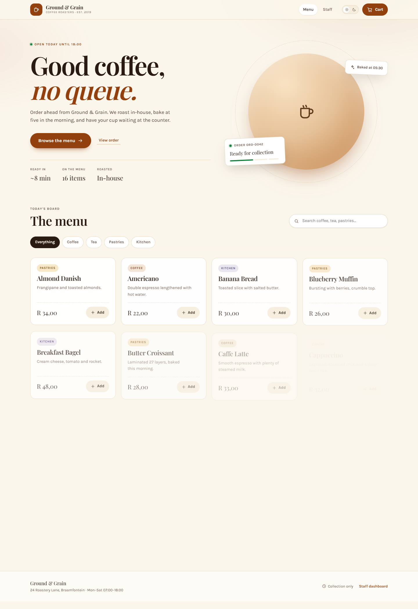
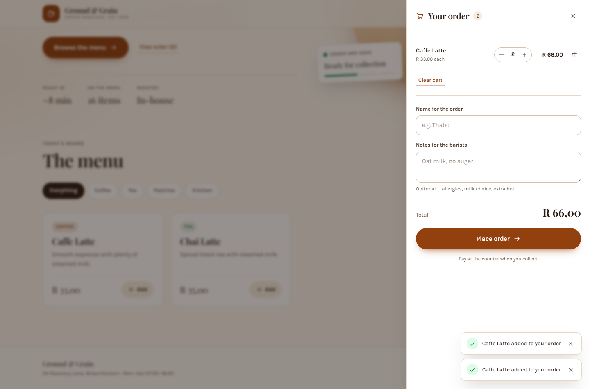
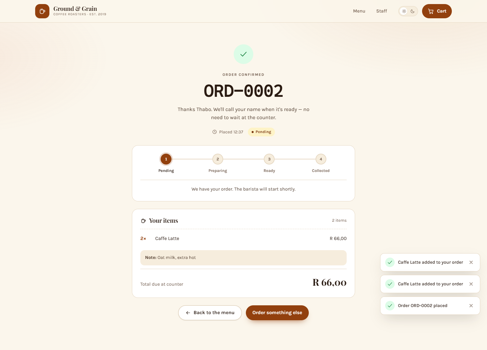
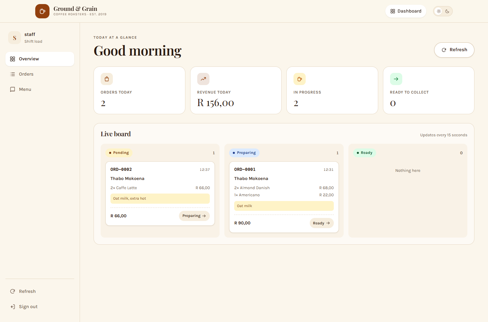
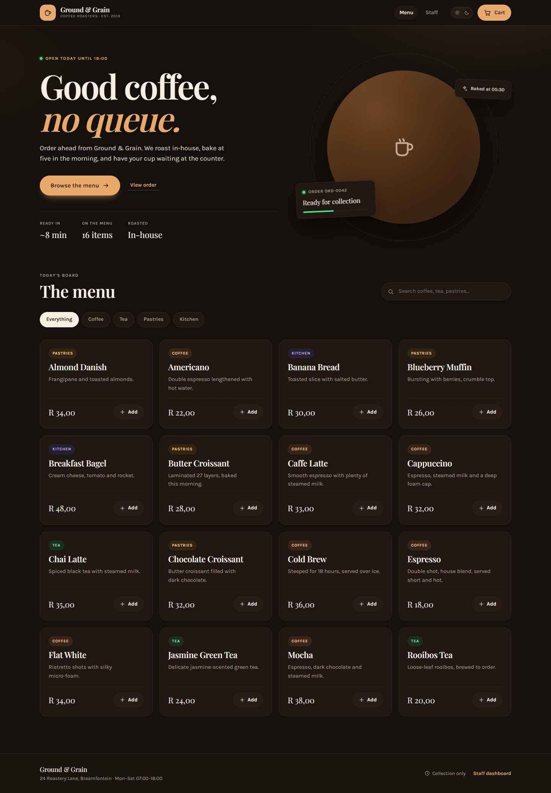

# Ground &amp; Grain — Coffee Shop Management System

A full-stack coffee shop ordering application built for the **BIWA2110 Web Application Development** group assignment.

Customers browse the menu, build a cart and place an order. Staff sign in to manage the menu, work the order queue and watch daily totals. Every menu item and order lives in a **key-value NoSQL store** with a JSON value under a unique key, accessed through an **Express REST API** from a **React** frontend using the **Fetch API**.



| Cart | Confirmation |
| --- | --- |
|  |  |

| Staff dashboard | Dark mode |
| --- | --- |
|  |  |

---

## Contents

- [Live deployment](#live-deployment)
- [Features](#features)
- [Tech stack](#tech-stack)
- [Architecture](#architecture)
- [Quick start](#quick-start)
- [Environment variables](#environment-variables)
- [API reference](#api-reference)
- [Data model](#data-model)
- [Project structure](#project-structure)
- [Tests](#tests)
- [Deployment](#deployment)
- [Design system](#design-system)
- [Customising](#customising)
- [Known limitations](#known-limitations)

---

## Live deployment

| Service | URL | Notes |
| --- | --- | --- |
| Frontend | <https://coffee-shop-omega-lovat.vercel.app> | React SPA on Vercel |
| API | <https://ground-and-grain-api.onrender.com> | `GET /api/health` → `200`, driver `redis` |
| Database | Upstash Redis (`intense-muskrat-98198.upstash.io`) | `REDIS_URL` set on Render only |

> Free Render instances sleep after inactivity, so the first request may take up to a minute.

Step-by-step instructions, including the CORS step that trips most people up, are in
[`DEPLOY.md`](./DEPLOY.md).

---

## Features

### Customer

- Menu grouped into Coffee, Tea, Pastries and Kitchen, with search and category filters.
- Each item shows name, description, price and availability; sold-out items cannot be added.
- Slide-over cart with quantity steppers, live totals and `localStorage` persistence across refreshes.
- Checkout asks for a name and optional barista note, validates inline, and returns a **unique order number** (`ORD-0001`).
- Confirmation page with a four-step status tracker that polls every 10 seconds, so the customer sees the order move to *Ready* without reloading.

### Staff

- JWT-protected dashboard; every write endpoint is behind `requireStaff`.
- **Overview**: orders today, revenue today, work in progress, ready to collect, plus a live three-column board.
- **Orders**: filterable table with one-click status advancement.
- **Menu**: create, edit, delete, and an availability switch. Deleting an item that sits in an open order is blocked with `409`.
- Status workflow is enforced server-side: `pending → preparing → ready → collected`, forward only.

### Platform

- Zod validation on every write, with a single consistent error envelope.
- Rate limiting on login and order creation; `helmet` security headers; strict CORS in production.
- Persistence survives restarts (Redis, or the JSON file driver used for local development).
- Light and dark themes, keyboard-accessible throughout, `prefers-reduced-motion` respected.

---

## Tech stack

| Layer | Choice | Why |
| --- | --- | --- |
| Frontend | React 18 + Vite | Fast dev server, tiny production bundle, no framework overhead |
| Routing | react-router-dom | Real URLs for the confirmation page so it can be shared |
| Styling | Hand-written CSS with design tokens | No build step for styles, full control over the design system |
| Backend | Express 4 (ESM) | Familiar REST routing, minimal ceremony |
| Validation | Zod | One schema per endpoint, machine-readable error details |
| Auth | JWT + bcryptjs | Stateless staff session, hash never leaves the server |
| Database | Redis (ioredis) | Key-value with persistence, sets and sorted sets for indexes |
| Testing | Vitest + Supertest | Fast, no browser needed for API coverage |

---

## Architecture

```
┌──────────────────────────────┐
│  React SPA                   │
│  Vercel / Netlify            │
│  · menu + cart               │
│  · confirmation              │
│  · staff dashboard           │
└──────────────┬───────────────┘
               │  Fetch API (JSON, Bearer token)
               ▼
┌──────────────────────────────┐
│  Express REST API            │
│  Render                      │
│  · /api/menu                 │
│  · /api/orders               │
│  · /api/auth                 │
│  · /api/health               │
└──────────────┬───────────────┘
               │  ioredis
               ▼
┌──────────────────────────────┐
│  Key-value NoSQL store       │
│  Upstash / Render KV         │
│  menu:item:{id} → JSON       │
│  order:{id}     → JSON       │
└──────────────────────────────┘
```

The frontend never talks to the database. It only knows the API base URL, injected at build time through `VITE_API_URL`.

---

## Quick start

**Prerequisites:** Node.js 20 or newer. Redis is optional — without it the API falls back to a JSON file.

### 1. API

```bash
cd server
npm install
cp .env.example .env      # Windows: copy .env.example .env
npm run seed              # loads 16 menu items
npm run dev               # http://localhost:4000
```

Check it:

```bash
curl http://localhost:4000/api/health
```

### 2. Frontend

In a second terminal:

```bash
cd client
npm install
cp .env.example .env.local
npm run dev               # http://127.0.0.1:5180
```

### 3. Sign in as staff

Open <http://127.0.0.1:5180/staff> and use:

| Username | Password |
| --- | --- |
| `staff` | `coffee123` |

That demo password only exists while `STAFF_PASSWORD_HASH` is empty. Set a real one:

```bash
cd server
npm run hash -- "your-new-password"
# paste the output into .env as STAFF_PASSWORD_HASH=...
```

> If port 5173 is taken on your machine, the client is configured for **5180**. Change `server.port` in `client/vite.config.js` and `FRONTEND_URL` in `server/.env` together.

---

## Environment variables

### `server/.env`

| Variable | Required | Default | Purpose |
| --- | --- | --- | --- |
| `PORT` | no | `4000` | API port (Render sets this itself) |
| `NODE_ENV` | no | `development` | `production` enables strict CORS |
| `FRONTEND_URL` | prod | `http://localhost:5173` | Allowed browser origin(s), comma-separated |
| `STAFF_USERNAME` | no | `staff` | Staff login name |
| `STAFF_PASSWORD_HASH` | prod | _empty_ | bcrypt hash from `npm run hash` |
| `JWT_SECRET` | prod | dev placeholder | Signing key for staff tokens |
| `JWT_EXPIRES_IN` | no | `8h` | Token lifetime |
| `REDIS_URL` | prod | _empty_ | `rediss://…` for Upstash / Render KV |
| `STORE_DRIVER` | no | auto | Force `redis` or `file` |

### `client/.env.local`

| Variable | Required | Default | Purpose |
| --- | --- | --- | --- |
| `VITE_API_URL` | yes | `http://localhost:4000` | API base URL, no trailing slash |

Vite reads `VITE_*` at **build** time. Changing it on Vercel/Netlify requires a redeploy.

---

## API reference

Full request/response examples live in [`docs/api.md`](docs/api.md).

| Method | Endpoint | Auth | Success |
| --- | --- | --- | --- |
| `GET` | `/api/health` | public | `200` (or `503` if the store is down) |
| `GET` | `/api/menu` | public | `200` |
| `GET` | `/api/menu/:id` | public | `200` / `404` |
| `POST` | `/api/menu` | staff | `201` |
| `PUT` | `/api/menu/:id` | staff | `200` |
| `DELETE` | `/api/menu/:id` | staff | `204` / `409` |
| `GET` | `/api/orders` | staff | `200` |
| `GET` | `/api/orders/summary/today` | staff | `200` |
| `GET` | `/api/orders/:id` | public | `200` / `404` |
| `POST` | `/api/orders` | public | `201` |
| `PATCH` | `/api/orders/:id/status` | staff | `200` / `409` |
| `POST` | `/api/auth/login` | public | `200` / `401` |

Every error uses the same shape:

```json
{
  "error": {
    "code": "VALIDATION_ERROR",
    "message": "Some fields are invalid",
    "details": [{ "field": "priceCents", "message": "Price must be at least R0.50" }]
  }
}
```

---

## Data model

The store is key-value, so listing and filtering are powered by explicit indexes rather than queries. Full rationale in [`docs/data-model.md`](docs/data-model.md).

```
menu:item:{id}          → JSON   menu item
menu:index              → SET    all menu item ids
menu:category:{cat}     → SET    item ids per category

order:{id}              → JSON   order with snapshotted line prices
orders:index            → ZSET   order id scored by created-at
orders:status:{status}  → SET    order ids per status
orders:day:{YYYY-MM-DD} → SET    order ids per day
stats:day:{YYYY-MM-DD}  → HASH   { orderCount, revenueCents }
counter:order           → INCR   source of ORD-0001 numbers
```

Three deliberate decisions:

1. **Prices are snapshotted onto the order line.** Changing a menu price tomorrow must not rewrite yesterday's receipt.
2. **Multi-key writes are atomic.** Creating an order writes the document and all four indexes in one `MULTI`.
3. **`KEYS *` is never used.** Every listing goes through an index set, which stays fast as the data grows.

Prices are stored as **integer cents** (`priceCents`) so totals never accumulate floating-point error.

---

## Project structure

```
coffee-shop/
├── client/                    React app (Vite)
│   ├── src/
│   │   ├── components/        Header, MenuCard, CartDrawer, ui primitives, icons
│   │   ├── context/           Cart, Auth, Toast providers
│   │   ├── pages/             MenuPage, ConfirmPage, StaffLogin, StaffDashboard
│   │   ├── lib/               formatting, theme hook
│   │   ├── styles/            tokens.css, app.css
│   │   └── api.js             single fetch wrapper
│   └── .env.example
├── server/                    Express API
│   ├── src/
│   │   ├── store/             redis driver + file driver (same interface)
│   │   ├── repositories/      menu + orders data access
│   │   ├── routes/            menu, orders, auth, health
│   │   ├── middleware/        auth, validation, error handling
│   │   ├── schemas.js         Zod schemas
│   │   ├── app.js             app factory (testable)
│   │   └── index.js           server bootstrap
│   ├── test/api.test.js       10 API tests
│   └── .env.example
├── docs/                      api.md, data-model.md, contributions.md
├── design-system/             MASTER.md + per-page overrides
└── README.md
```

---

## Tests

```bash
cd server
npm test
```

Covers the health check, public menu reads, auth rejection, validation errors, server-side total recalculation, unavailable items, forward-only status transitions, the delete guard and the daily summary.

---

## Deployment

Full walkthrough: [`DEPLOY.md`](./DEPLOY.md). The short version:

### 1. Database — Upstash (free, persistent)

1. Create a Redis database at <https://upstash.com>.
2. Copy the `rediss://…` connection string.

### 2. API — Render

1. New **Web Service**, root directory `server`.
2. Build: `npm ci` · Start: `npm start`.
3. Environment:

```
NODE_ENV=production
REDIS_URL=rediss://...
FRONTEND_URL=https://your-app.vercel.app
JWT_SECRET=<long random string>
STAFF_USERNAME=staff
STAFF_PASSWORD_HASH=<from npm run hash>
```

4. Verify `https://your-api.onrender.com/api/health` returns `200` with `"store":{"driver":"redis","ok":true}`.

A `render.yaml` blueprint at the repo root sets all of this up in one step.

The menu seeds itself the first time the API boots against an empty database, so a fresh deploy
is usable immediately. Set `AUTO_SEED=false` to skip that.

> Free Render services sleep after inactivity. Open the health URL a minute before your demo to warm it up.

### 3. Frontend — Vercel or Netlify

| Setting | Vercel | Netlify |
| --- | --- | --- |
| Root directory | `client` | `client` |
| Build command | `npm run build` | `npm run build` |
| Output directory | `dist` | `dist` |
| Env var | `VITE_API_URL=https://your-api.onrender.com` | same |

Because the app uses `BrowserRouter`, add a rewrite so deep links like `/order/:id` resolve:

- **Vercel** — `client/vercel.json` with a rewrite of all paths to `/index.html`.
- **Netlify** — `client/public/_redirects` containing `/* /index.html 200`.

Both files are included.

---

## Design system

`design-system/ground-and-grain/MASTER.md` is the single source of truth for colour, type, spacing and motion, generated with the `ui-ux-pro-max` skill and then tuned:

- **Palette** — warm brown `#92400E` on cream `#FBF6EC`, with a full dark-mode counterpart. All colours are semantic tokens; components never hard-code hex.
- **Type** — Playfair Display for display, Karla for body, system mono for order numbers.
- **Page overrides** live in `design-system/ground-and-grain/pages/` — the dashboard runs denser than the marketing surface.

Every token is defined once in `client/src/styles/tokens.css`.

---

## Customising

Everything you would want to change is in one place:

| Change | Where |
| --- | --- |
| Shop name, tagline, address | `client/src/components/Header.jsx`, `MenuPage.jsx` footer |
| Currency | `client/src/lib/format.js` — one `Intl.NumberFormat` call at the top |
| Prices and menu | Seed list in `server/src/seed.js`, or the staff **Menu** tab at runtime |
| Colours, type, radii | `client/src/styles/tokens.css` (light and dark are separate blocks) |
| Category names shown to customers | `CATEGORY_LABELS` in `client/src/lib/format.js` |

The currency is South African rand (`en-ZA`, `ZAR`). To switch, change those two arguments in
`format.js` — nothing else reads the currency directly.

---

## Known limitations

- **Single staff account.** The brief asks for staff-only endpoints, not a user system. A role model would be the next step.
- **Collection only.** No payment gateway, no delivery, no email receipts.
- **Order history grows in one index.** Fine at assignment scale; a production system would archive orders by month.
- **The file store is a development convenience.** It is single-process and not suitable for a deployed API.
- **No drag-and-drop on the board.** Status changes are explicit buttons, which is more reliable on touch and keyboard.

---

## Group contributions

See [`docs/contributions.md`](docs/contributions.md) for the branch, PR and per-member ownership record required by the brief.
